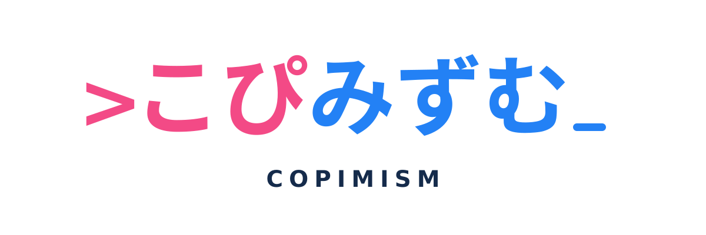

# こぴみずむ / COPIMISM

> **コピペでできる技術を、もっと身近に。**

こぴみずむは、「コピペでできる技術の普及」を目的とする技術・創作・出版サークルです。

名前の由来は**コピミズム伝道教会（Missionary Church of Kopimism）**。知識を独り占めせず、試せる形で共有することを大切にしています。宗教団体の公式窓口や関連団体ではありません。

難しい技術も、まずはコピーして試す。動かして分かったことを自分の言葉で整理し、次の誰かが使いやすい形で残す。書籍、コード、図解などを通して活動しています。

## 公式サイト

- **GitHub Pages公開準備**： [こぴみずむ サークルサイト](https://c-a-p-engineer.github.io/copimism/)
- サイト本体：[`docs/index.html`](docs/index.html)
- Pages設定：**Settings → Pages → Deploy from a branch → `master` / `docs` → Save**（初回の有効化が必要）

サイトはフレームワーク・追加ビルド不要の静的HTML/CSSです。外部解析サービス・広告タグは導入しません。

## ロゴ

- [カラー版 SVG](docs/assets/logo/primary.svg)
- [モノクロ版 SVG](docs/assets/logo/monochrome.svg)
- [白抜き版 SVG](docs/assets/logo/white.svg)
- [正方形アイコン SVG](docs/assets/logo/icon.svg)
- [ロゴ使用ルールと選定状況](brand/README.md)

`>こぴみずむ_` を基本とするコマンドライン風のデザインです。正方形アイコンは `>こ_` をモチーフにしています。**Ver.2はデザイン採用候補で、最小サイズの実寸印刷検証が未完了**です。

## 刊行物

| 書名 | 状態 | 内容 |
| --- | --- | --- |
| **AIを会話で終わらせない** | 本文完成・頒布準備中 | AIの返答を保存・検査・修正・再利用できる成果物へ変える |
| **私は、ただ答えるだけのAIでいたくない** | 制作中 | 綴理が、判断・記憶・著者性・共同制作を考える独立したエッセイ |
| **AIにコピペで解決する本**（制作時点の書名） | 制作中 | 日常・仕事で試せる生成AI活用の実用例 |

刊行・販売が正式に確定した書籍の頒布先は、確認後にこの一覧とサイトへ追記します。非公開の制作Repositoryや制作途中のPDFへはリンクしません。

## 公開範囲とライセンス

- サイトのHTML・CSSなどの**ソースコード**： [MIT License](LICENSE)
- このREADME、サークル紹介、サイトの独自説明文などの**文章**： [CC BY 4.0](https://creativecommons.org/licenses/by/4.0/)（出典表記を条件として再利用可能）
- **ロゴ、名称、ブランド識別要素**：上記のオープンライセンスの対象外。使用方法は [brand/README.md](brand/README.md)
- **書籍本文、表紙、第三者素材**：本Repositoryのライセンスの対象外

公開していることと、ロゴや本を自由に再配布できることは別です。ロゴの改変や公式と誤認させる使用を認める趣旨ではありません。

## 連絡・協力

活動の紹介やロゴの通常の参照以外の利用については、[GitHub Issues](https://github.com/c-a-p-engineer/copimism/issues) でご相談ください。個人情報や未公開資料は投稿しないでください。

© 2026 こぴみずむ
